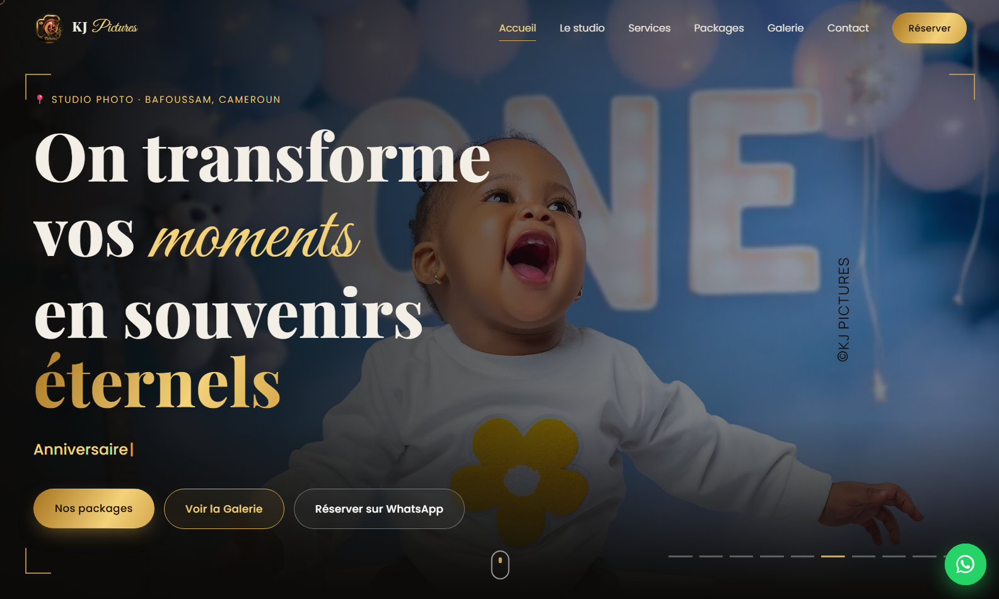
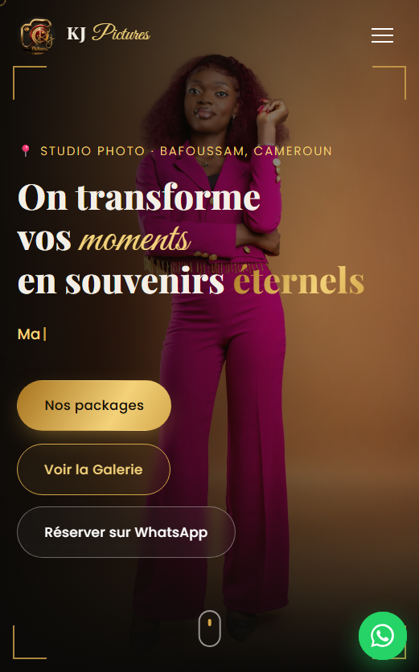
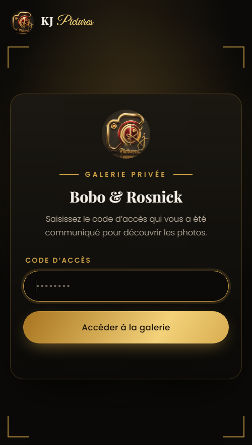
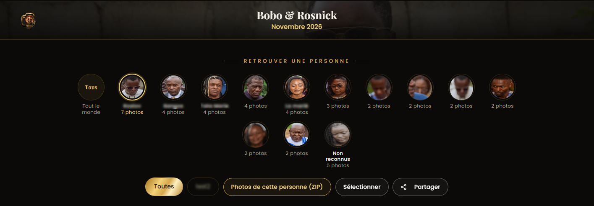

# KJ Pictures

<p align="center">
  <strong>Studio photo à Bafoussam, Cameroun</strong><br>
  Mariage · portraits · anniversaires · famille · mode · tradition
</p>

<p align="center">
  <a href="https://kjpicturescm.duckdns.org/"><strong>Découvrir le site</strong></a>
</p>

KJ Pictures transforme les moments importants en souvenirs durables : séances au studio, portraits professionnels, événements, shootings famille et créations inspirées de la culture camerounaise.





## Une expérience simple pour réserver

- découvrir les prestations et les formules disponibles ;
- parcourir les créations par univers photo ;
- préparer une demande de réservation directement sur WhatsApp ;
- contacter le studio à Bafoussam pour une séance ou un événement sur mesure.

Le site public est disponible sur **[kjpicturescm.duckdns.org](https://kjpicturescm.duckdns.org/)**.

## Galerie privée d’événement

Après un mariage, un anniversaire ou une séance, les photos peuvent être partagées dans une galerie privée. Chaque invité reçoit un lien et un code d’accès : les images ne sont pas affichées avant la validation de ce code.



La galerie privée propose aussi une recherche par personne après validation du code d’accès.



Les captures ont été fournies par KJ Pictures pour présenter cette expérience privée.

## Développement local

```bash
npm install
npm start
```

Le site est alors disponible sur `http://localhost:3000`.
